  

# 🔬 Awesome Reverse Engineering & Binary Analysis Platforms 🛡️

  
  
  
  
  

> 🚀 **A comprehensive, SEO-optimized, curated guide to leading Reverse Engineering (SRE) frameworks, binary analysis software, disassemblers, decompilers, malware triage sandboxes, and firmware security tools.** Featuring in-depth pricing breakdowns, free tier limits, corporate revenue/valuation metrics, and ranked open-source repositories.
>
> 🌟 *Star this repository if you find it helpful for your reverse engineering research and security workflows!* 🌟

---

## 📑 Table of Contents
- [📈 Sector Overview & Market Dynamics](#-sector-overview--market-dynamics)
- [🟦 Commercial & SaaS Binary Analysis Platforms](#-commercial--saas-binary-analysis-platforms)
- [🟩 Leading Open-Source SRE Tools & Frameworks](#-leading-open-source-sre-tools--frameworks)
- [🔍 Architectural Feature Comparison](#-architectural-feature-comparison)
- [🤝 Contributing & Community Guidelines](#-contributing--community-guidelines)
- [💖 Support & Sponsorship](#-support--sponsorship)
- [⭐ Star History](#-star-history)
- [📄 License](#-license)

---

## 📈 Sector Overview & Market Dynamics

The global **binary analysis and software reverse engineering market** is valued at approximately **$1.63 billion** and is projected to expand at a compound annual growth rate (**CAGR) of ~17.2%**, surpassing **$5.4 billion by the early 2030s**. 

The sector is **highly fragmented**, split between deeply entrenched legacy commercial standards (e.g., Hex-Rays' IDA Pro), robust defense-backed open-source frameworks (notably NSA's Ghidra and community staple Radare2/Rizin), and a rapidly accelerating wave of specialized startups targeting firmware security, binary Software Bill of Materials (SBOM), and agentic LLM/AI-driven binary introspection.

---

## 🟦 Commercial & SaaS Binary Analysis Platforms

Commercial reverse engineering and binary analysis solutions sorted descending by **Company Scale (Valuation / Annual Revenue)**.

| 🏢 Platform | 💰 Starting Tier Pricing | 🎁 Free Tier / Trial Limits | 📊 Company Scale (Valuation / Revenue) | 🎯 Primary Focus & Strengths |
| :--- | :--- | :--- | :--- | :--- |
| **[ReversingLabs Spectra Analyze](https://www.reversinglabs.com/)** | **$31,261/yr** (Enterprise entry; median ~$61,667/yr) | **14-day enterprise proof-of-concept trial** (scoping required; no self-serve free forever tier) | **~$340M–$900M valuation** (~$75M–$83M ARR; ~$131M funding) | 🏢 Enterprise-scale binary inspection, threat hunting, and 400+ file format static/dynamic triage |
| **[IDA Pro Cloud](https://hex-rays.com/)** (Hex-Rays) | **€1,099/yr** ($1,099/yr for IDA Pro Essential with 2 cloud decompilers) | **Free forever via IDA Free** (strictly non-commercial; restricted to x86 32/64-bit; cloud-only decompiler; no commercial use) | **~$100M+ valuation** (€20M+ historical annual revenue; acquired by Smartfin PE) | 🏆 De facto industry gold standard interactive disassembler and multi-architecture decompiler |
| **[Intezer Analyze](https://www.intezer.com/)** | **$40–$60/host/yr** (or custom endpoint quote with unlimited alert ingestion) | **Free forever Community Edition** (10 public file scans/month; includes 14-day initial trial with up to 500 alert investigations) | **~$80M–$100M valuation** (~$10M ARR; $60M total venture funding) | 🧬 Genetic malware analysis, binary code reuse detection, and autonomous SOC incident triage |
| **[VMRay Analyzer](https://www.vmray.com/)** | **$2,700/yr** (Investigator single-user license) | **30-day proof-of-concept enterprise trial** (custom scoping; no self-serve free forever plan) | **~$60M+ valuation** (~$25M–$30M ARR; $62.9M venture funding) | 🛡️ Evasion-resistant hypervisor-based agentless malware detonator and behavioral analysis sandbox |
| **[Binarly](https://www.binarly.io/)** | **$1,200/yr** (Lite individual tier; custom enterprise) | **Free forever via Binary Risk Hunt** (`risk.binarly.io`, unlimited basic web scans & SBOM generation without registration; 30-day Starter trial for API/reports) | **~$40M–$100M valuation** (~$1M–$7M ARR; $14.1M venture funding) | 🔌 Firmware security, software supply chain vulnerability detection, and automated binary SBOMs |
| **[RevEng.AI](https://reveng.ai/)** | **$3,600/yr** (B2B team seat estimate; custom enterprise/defense) | **Product demo & evaluation upon request** (custom scoped technical evaluation trial; no public free forever tier) | **~$25M–$40M valuation** ($19.5M+ total funding led by NATO Innovation Fund & In-Q-Tel) | 🤖 AI-native binary decompilation, BinNet embeddings, and source-less zero-day vulnerability analysis |
| **[Binary Ninja Cloud](https://binary.ninja/)** (Vector 35) | **$199/yr** (Non-commercial personal license; $1,799/yr Commercial) | **Free forever via Binary Ninja Cloud** (web-only; PE/ELF/Mach-O only; no Python API; no plugins; strict binary size limits; uploads used for dataset training) | **~$10M–$20M valuation** (~$2M–$5M ARR; bootstrapped with strategic In-Q-Tel backing) | ⚡ Modern Intermediate Language (BNIL), rapid multi-threaded analysis, and collaborative decompilation |
| **[JEB Decompiler](https://www.pnfsoftware.com/)** (PNF Software) | **$1,200/yr** ($140/mo for JEB Android; $2,000/yr for JEB Pro) | **Free forever via JEB Community Edition (CE)** (desktop-only; limited exclusively to x86 32/64-bit; includes full API & decompilation for non-commercial/hobby use) | **~$5M–$10M valuation** (~$1M–$3M annual revenue; privately held boutique) | 📱 Premier Android/Dalvik decompilation, multi-architecture reverse engineering, and rich Java/Python API |

---

## 🟩 Leading Open-Source SRE Tools & Frameworks

Ranked descending by **GitHub Stargazers ⭐** (badges linked directly to repo stargazers):

### 1. 🥇 [Ghidra](https://github.com/NationalSecurityAgency/ghidra)

* **GitHub Repository:** [NationalSecurityAgency/ghidra](https://github.com/NationalSecurityAgency/ghidra) 🌟 **101,243+ Stars**
* **Tech Stack:** Java, C++, Python | **License:** Apache-2.0
* **Overview:** Developed by the National Security Agency (NSA) Research Directorate, Ghidra is the premier free and open-source Software Reverse Engineering (SRE) suite. It features full disassembly, assembly, decompilation, control-flow graphing, headless automation, and a multi-user collaborative Ghidra Server for team-based analysis.

### 2. 🥈 [ImHex](https://github.com/WerWolv/ImHex)

* **GitHub Repository:** [WerWolv/ImHex](https://github.com/WerWolv/ImHex) 🌟 **56,041+ Stars**
* **Tech Stack:** C++, ImGui | **License:** GPL-2.0
* **Overview:** A feature-rich, modern hex editor tailored for reverse engineers, malware analysts, and security researchers. Includes custom Pattern Language for binary parsing, visual node-based data preprocessors, disassembly views, and memory-safe diffing tools.

### 3. 🥉 [x64dbg](https://github.com/x64dbg/x64dbg)

* **GitHub Repository:** [x64dbg/x64dbg](https://github.com/x64dbg/x64dbg) 🌟 **50,387+ Stars**
* **Tech Stack:** C++, Qt | **License:** GPL-3.0
* **Overview:** An open-source x64/x32 binary debugger for Windows. Equipped with an intuitive Qt GUI, TitanEngine-backed core, C-like expression parser, dynamic symbol resolution, and an extensive plugin ecosystem.

### 4. 🏅 [radare2](https://github.com/radareorg/radare2)

* **GitHub Repository:** [radareorg/radare2](https://github.com/radareorg/radare2) 🌟 **25,504+ Stars**
* **Tech Stack:** C | **License:** LGPL-3.0
* **Overview:** A legendary, highly portable UNIX-like command-line reverse engineering and binary analysis framework. Powers disassembly, hexediting, binary patching, code diffing, filesystem extraction, and scriptable forensics across nearly every architecture.

### 5. 🏅 [Cutter](https://github.com/rizinorg/cutter)

* **GitHub Repository:** [rizinorg/cutter](https://github.com/rizinorg/cutter) 🌟 **20,263+ Stars**
* **Tech Stack:** C++, Qt, Rizin | **License:** GPL-3.0
* **Overview:** A sleek, user-friendly Qt desktop GUI powered by the Rizin reverse engineering framework. Integrates Ghidra decompiler modules, native debugging, binary graphing, and Python/Jupyter plugin support.

### 6. 🏅 [angr](https://github.com/angr/angr)

* **GitHub Repository:** [angr/angr](https://github.com/angr/angr) 🌟 **9,415+ Stars**
* **Tech Stack:** Python, C | **License:** BSD-2-Clause
* **Overview:** A powerful multi-architecture binary analysis platform developed by UC Santa Barbara and the SECLAB. Combines symbolic execution, abstract interpretation, dynamic binary instrumentation, and vulnerability discovery pipelines.

### 7. 🏅 [RetDec](https://github.com/avast/retdec)

* **GitHub Repository:** [avast/retdec](https://github.com/avast/retdec) 🌟 **8,675+ Stars**
* **Tech Stack:** C++, LLVM | **License:** MIT
* **Overview:** A retargetable machine-code decompiler based on LLVM, originally built by AVG/Avast. Supports PE, ELF, COFF, AR, and raw binaries across x86, ARM, MIPS, and PIC architectures with static code optimization.

### 8. 🏅 [capa](https://github.com/mandiant/capa)

* **GitHub Repository:** [mandiant/capa](https://github.com/mandiant/capa) 🌟 **6,360+ Stars**
* **Tech Stack:** Python | **License:** Apache-2.0
* **Overview:** Mandiant's automated capability identification tool for unknown executables. Uses open YAML-based rules to detect ATT&CK techniques, obfuscation mechanisms, anti-debugging tricks, and malware behaviors in seconds.

### 9. 🏅 [Triton](https://github.com/JonathanSalwan/Triton)

* **GitHub Repository:** [JonathanSalwan/Triton](https://github.com/JonathanSalwan/Triton) 🌟 **4,383+ Stars**
* **Tech Stack:** C++, Python | **License:** Apache-2.0
* **Overview:** A Dynamic Binary Analysis (DBA) framework providing taint analysis, dynamic symbolic execution (DSE), constraint solvers via Z3/Bitwuzla, and AST representations for automated exploit and de-obfuscation research.

### 10. 🏅 [Rizin](https://github.com/rizinorg/rizin)

* **GitHub Repository:** [rizinorg/rizin](https://github.com/rizinorg/rizin) 🌟 **4,228+ Stars**
* **Tech Stack:** C | **License:** LGPL-3.0
* **Overview:** A modern fork of radare2 focusing on stability, clean APIs, consistent codebase maintenance, and modular architecture. Acts as the core backend engine powering the Cutter GUI.

### 11. 🏅 [OGhidra](https://github.com/LLNL/OGhidra)

* **GitHub Repository:** [LLNL/OGhidra](https://github.com/LLNL/OGhidra) 🌟 **473+ Stars**
* **Tech Stack:** Python, Java | **License:** BSD-3-Clause
* **Overview:** Developed by Lawrence Livermore National Laboratory (LLNL) and sponsored by the USDOE/NNSA. Employs local Agentic AI to automate Ghidra workflows, identify vulnerabilities, and analyze malware without exposing sensitive binaries to cloud APIs.

---

## 🔍 Architectural Feature Comparison

| 🛠️ Platform / Tool | 📜 License Model | 💻 Primary Stack | 🧩 Decompiler | ☁️ Cloud Hosted | 🏠 Self-Hosted | 🎯 Sweet Spot |
| :--- | :--- | :--- | :--- | :--- | :--- | :--- |
| **IDA Pro** | Proprietary | C++ | ✅ (x86, ARM, MIPS, etc.) | ✅ (Cloud Decompilers) | ✅ (Local App) | Industry-standard enterprise reversing |
| **Ghidra** | Apache-2.0 | Java / C++ | ✅ (Multi-architecture) | ❌ | ✅ (Ghidra Server) | NSA-backed zero-cost extensible SRE |
| **ImHex** | GPL-2.0 | C++ / ImGui | ❌ (Pattern Evaluator) | ❌ | ✅ | Deep binary structure inspection & hex editing |
| **x64dbg** | GPL-3.0 | C++ / Qt | ❌ (Debugger) | ❌ | ✅ | Windows PE active dynamic debugging |
| **radare2** | LGPL-3.0 | C | ✅ (r2dec / ghidra plugin) | ❌ | ✅ | Headless automation & command-line hacking |
| **Cutter** | GPL-3.0 | C++ / Qt | ✅ (Integrated Ghidra) | ❌ | ✅ | Modern intuitive desktop GUI for Rizin |
| **Binary Ninja** | Proprietary | C++ / Python | ✅ (BNIL Decompiler) | ✅ (Binary Ninja Cloud) | ✅ (Desktop/Enterprise) | Intermediate-language analysis & collaboration |
| **angr** | BSD-2-Clause | Python / C | ✅ (angr-decompiler) | ❌ | ✅ | Symbolic execution & exploit generation |
| **RetDec** | MIT | C++ / LLVM | ✅ (LLVM-based) | ❌ | ✅ | Multi-architecture LLVM decompilation |
| **capa** | Apache-2.0 | Python | ❌ (Capability Matcher) | ❌ | ✅ | Rapid automated malware behavioral triage |
| **Intezer** | Proprietary | Cloud SaaS | ❌ (Code DNA Graph) | ✅ | ❌ | Enterprise malware classification & SOC triage |
| **VMRay** | Proprietary | Cloud / On-Prem | ❌ (Sandbox Detonation) | ✅ | ✅ (On-premise appliance) | Hypervisor-level evasion-proof sandboxing |
| **Binarly** | Proprietary | Cloud SaaS | ❌ (Vulnerability/SBOM) | ✅ | ❌ | Firmware supply-chain & binary SBOM validation |
| **RevEng.AI** | Proprietary | Cloud AI | ✅ (AI-driven) | ✅ | ❌ | Deep AI binary embeddings & backdoor hunting |
| **JEB Decompiler** | Proprietary / Free CE | Java | ✅ (Dalvik, x86, ARM) | ❌ | ✅ | Android APK & Dalvik reverse engineering |
| **Triton** | Apache-2.0 | C++ / Python | ❌ (Taint Engine) | ❌ | ✅ | Dynamic taint analysis & symbolic verification |
| **OGhidra** | BSD-3-Clause | Python / Java | ✅ (Ghidra Agentic AI) | ❌ | ✅ | Local air-gapped AI-driven binary exploration |

---

## 🤝 Contributing & Community Guidelines

Contributions and recommendations are warmly appreciated! To propose a new reverse engineering tool, binary analysis engine, or firmware disassembler:

1. **Fork the Repository** and create a feature branch (`git checkout -b feature/new-tool`).
2. Verify the project meets the inclusion criteria:
   - Actively maintained (commit or release within the last 12 months).
   - Clear utility for reverse engineers, malware analysts, or vulnerability researchers.
3. Submit a Pull Request detailing the software name, license, starting price / Stars_Count, and unique strengths.

---

## 💖 Support & Sponsorship

Thank you for exploring this curated repository! If you find this list helpful for your research, security investigations, or tooling setup, please consider supporting the project:

- ⭐ **Star this repository** to help others discover it across GitHub.
- 🍴 **Fork and share** it with fellow reverse engineers, malware analysts, and cybersecurity enthusiasts.
- ☕ **Buy me a coffee / Sponsor**: Support ongoing maintenance and curation via the [GitHub Sponsors Dashboard](https://github.com/sponsors/ishandutta2007).

---

## ⭐ Star History

---

## 📄 License

This repository and curated list are published under the [Creative Commons Zero v1.0 Universal](LICENSE) (CC0 1.0) Public Domain Dedication. All referenced logos, brand names, and tool trademarks belong to their respective creators and organizations.

---

  <b>⭐ Found this useful? Consider starring the repository to help fellow analysts discover it! ⭐</b>

